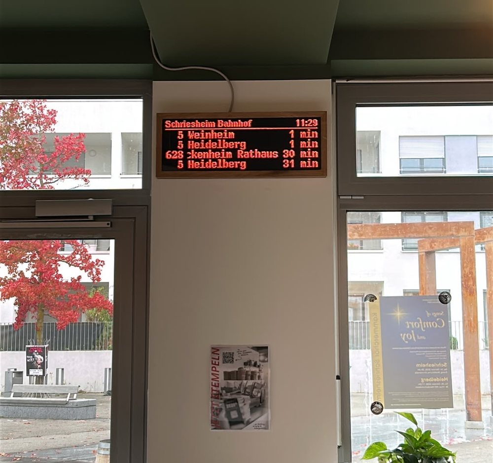
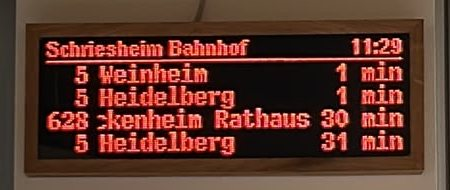
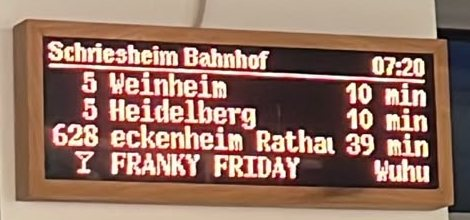
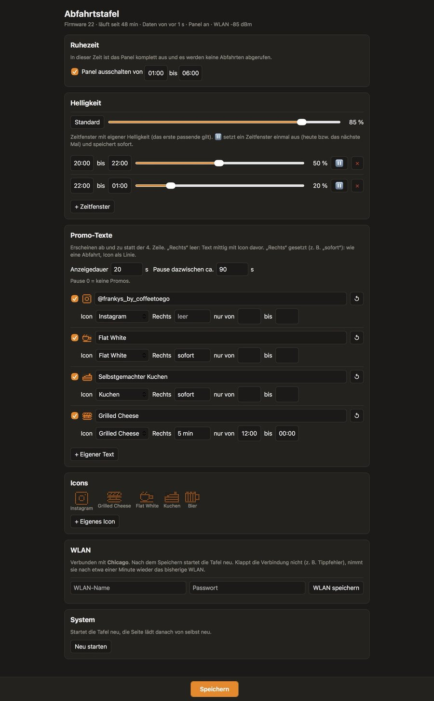

# FRANKY'S Bahnabfahrtstafel

Eine kleine Abfahrtstafel für **[FRANKY'S](https://frankys-schriesheim.de)**, das Café direkt
am Bahnhof in Schriesheim. Sie zeigt, wann die nächsten Bahnen und Busse am
**Schriesheim Bahnhof** abfahren – so kann man in Ruhe seinen Kaffee austrinken und erwischt
trotzdem seine Bahn.

- 🌐 Website: <https://frankys-schriesheim.de>
- 📸 Instagram: [@frankys_by_coffeetoego](https://www.instagram.com/frankys_by_coffeetoego/)

<p align="center">
  
</p>

## Was die Tafel kann

Die Tafel sieht aus wie die orangefarbenen LED-Anzeigen an den rnv-Haltestellen und zeigt die
nächsten Abfahrten mit Echtzeit, genau wie am Bahnsteig:

```
Schriesheim Bahnhof                     10:42
──────────────────────────────────────────────
 5  Heidelberg                         sofort
 5  Weinheim                            3 min
628 Wilhelmsfeld Autohalle              8 min
 5  Weinheim Alter OEG-Bahnhof          12 min
```

| Abfahrten mit Echtzeit | Promo-Zeile vom Café |
|---|---|
|  |  |

- **Echtzeit:** Verspätungen sind schon eingerechnet, ausfallende Fahrten zeigen `fällt aus`,
  und Störungsmeldungen laufen in der untersten Zeile durch.
- **Ein kleines Extra vom Café:** ab und zu zeigt eine Zeile eine Nachricht von Franky's,
  zum Beispiel den Instagram-Namen oder ein Angebot, mit einem kleinen Pixel-Symbol.
- **Kleine Bahnen:** hin und wieder fährt eine kleine Bahn oder ein Bus aus seiner Zeile,
  wenn er abfährt.
- **Bahnrennen:** wie das Pferderennen auf der Kirmes. Auf Knopfdruck fahren vier bunte
  Bahnen mit den Nummern 1–4 zufällig Feld für Feld über 12 Felder, manchmal auch eins zurück.
  Etwa jedes zehnte Rennen entgleist eine Bahn und bleibt stehen, und ab und zu ersetzt FRANKY'S ICE
  eine Bahn: Er wartet, bis die anderen halb durch sind, und rauscht dann ins Ziel – wenn er
  nicht ausfällt. In etwa jedem vierten Rennen (einstellbar) tanzt mittendrin ein Mexikaner mit Gitarre über
  die Tafel („¡FIESTA!“), und auf dem iPad läuft dazu „Fiesta Mexicana“. Wer zuerst im Ziel ist,
  gewinnt und bekommt eine Ehrenrunde mit Feuerwerk, danach kommt kurz die Rangliste. Setzen
  kann man auf eine Nummer. Das Rennen unterbricht nur, was gerade läuft: Danach zeigt die
  Tafel wieder die Abfahrten oder das Event.
- **Nachtruhe:** nachts schaltet sich die Tafel ab, am späten Abend wird sie dunkler.
- **Event-Modus:** Für eine Party oder einen besonderen Abend übernimmt die Tafel auf Knopfdruck
  ganz eigene Texte und Bilder in Farbe, bis man sie wieder auf die Abfahrten zurückschaltet.
- **Karaoke-Liste:** Beim Karaoke-Abend zeigt die Tafel, wer als Nächstes singt und was.
- **Rausschmeißer:** Zum Feierabend steht ein eigener Text erst groß auf der ganzen Tafel, dann
  läuft er durch die unterste Zeile, auch mitten im Event, bis die Tafel nachts ausgeht. Auf dem
  iPad läuft dazu das Rausschmeißer-Lied.
- **Letzte Runde:** Ein eigener Text als Laufschrift so hoch wie die ganze Tafel, für ein paar Sekunden, danach geht
  es weiter wie vorher.
- **St.-Pauli-Ticker:** Spielt St. Pauli, steht der Spielstand in der untersten Zeile, die
  Abfahrten bleiben darüber. Bei einem Tor für St. Pauli zeigt die ganze Tafel kurz
  „TOOOR!“ mit Feuerwerk, nach dem Abpfiff kommt der Endstand noch ein paar Stunden.
- **Leicht zu ändern:** Nachrichten, Symbole, Helligkeit und Zeiten lassen sich von jedem
  Handy, Tablet oder Laptop im Mitarbeiter-WLAN des Cafés ändern, ganz ohne Kabel.
- **Kümmert sich um sich selbst:** nach WLAN-Problemen verbindet sie sich neu, und Updates
  installiert sie von allein.

Die Abfahrtsdaten kommen vom Verkehrsverbund Rhein‑Neckar (VRN).

---

# Technische Details

Alles ab hier ist für alle, die die Tafel bauen, reparieren oder weiterentwickeln.

## Hardware

Ein ESP32-S3-DEV-KIT-N8R8 steuert drei Waveshare-22100-Panels (64×64, P3, HUB75E, 1/32 Scan),
die nebeneinander montiert sind. Das ergibt 192×64 Pixel.

Lange Ziele laufen durch (Pause, bis zum Ende schieben, Pause, zurückspringen).
Schriften und Layout stehen oben in `src/display/render.cpp`. Um ein Layout ohne Hardware anzusehen,
`tools/preview/run.sh` ausführen; es schreibt `tools/preview/preview.png`, die Bilder der
Abfahrtsanimation nach `tools/preview/preview_anim.png`, Beispiele des Event-Modus nach
`tools/preview/preview_event.png`, ein Bahnrennen nach `tools/preview/preview_race.png` und die
Karaoke-Liste nach `tools/preview/preview_karaoke.png`, den St.-Pauli-Ticker nach
`tools/preview/preview_match.png` und Rausschmeißer und Letzte Runde nach `tools/preview/preview_bouncer.png`.

## Datenquelle

Die Tafel liest den **VRN EFA Open Service** (Mentz RapidJSON). Er braucht weder API-Key noch
Login; das wurde am 08.10.2026 geprüft, und Echtzeitdaten sind enthalten.

```
https://www.vrn.de/mngvrn/XML_DM_REQUEST?outputFormat=rapidJSON&type_dm=any&mode=direct&useRealtime=1&name_dm=de:08226:3479&limit=20
```

`https://trias.vrn.de/vrn/XML_DM_REQUEST` ist der automatische Ausweich-Host. Der eigene
GraphQL-Data-Hub der rnv bräuchte einen API-Key, den man per E-Mail an opendata@rnv-online.de
beantragt. Dieses Projekt braucht ihn nicht.

Lizenz: *Datenlizenz Deutschland – Namensnennung*, Quelle **Verkehrsverbund Rhein‑Neckar (VRN)**.
Es gelten die [Nutzungsbedingungen](https://opendata.vrn.de/nutzungsbedingungen) des VRN.
Eine Registrierung ist nicht nötig. Wer möchte, kann sich unter
<https://opendata.vrn.de/user/register> kostenlos registrieren; einen API-Key gibt es dafür nicht.

### St.-Pauli-Ticker: ESPN

Die Spiele kommen aus der Site-API von [ESPN](https://www.espn.com/soccer/club/_/id/270/st-pauli),
kostenlos, ohne Key und Login (geprüft am 23.10.2026). Offiziell dokumentiert ist sie nicht,
ESPN könnte sie also ändern. Die Daten kommen von einem Datenanbieter und sind meist
schneller und vollständiger als bei OpenLigaDB, dem früheren Lieferanten. Die
Zertifikatskette endet wie beim VRN in ISRG Root X1.

```
…/apis/site/v2/sports/soccer/all/teams/270/schedule               Ergebnisse (alle Wettbewerbe)
…/apis/site/v2/sports/soccer/all/teams/270/schedule?fixture=true  kommende Spiele
…/apis/site/v2/sports/soccer/ger.2/scoreboard?dates=20261023      Spieltag einer Liga mit Toren
```

Ergebnisse und kommende Spiele holt die Tafel stündlich. Ab 5 Minuten vor dem Anstoß bis
zum Abpfiff fragt sie alle 15 Sekunden den Spieltag der Liga ab (`MATCH_*` in
`include/config.h`), nicht in der Ruhezeit, nicht im Event-Modus und nur, wenn der Ticker
an ist. Es zählen nur die Wettbewerbe in `MATCH_LEAGUES` (`ger.1,ger.2,ger.dfb_pokal`, also
auch nach einem Auf- oder Abstieg und im Pokal, aber keine Testspiele). Die Kürzel der
Vereine (`STP`, `H96`) liefert ESPN mit. Den letzten Torschützen zeigt die Tafel nur, wenn
die Tore schon alle eingetragen sind, sonst nur den Spielstand. Ein anderer Verein:
`MATCH_TEAM_ID`, die Nummer steht in der URL seiner ESPN-Seite (`…/club/_/id/270/st-pauli`).

### Eine andere Haltestelle?

1. Haltestellen-ID nachschlagen:
   `https://www.vrn.de/mngvrn/XML_STOPFINDER_REQUEST?outputFormat=rapidJSON&type_sf=any&name_sf=Heidelberg%20Bismarckplatz`
   und `locations[0].id` nehmen, z. B. `de:08221:1146`.
2. `STOP_ID` und `STOP_DISPLAY_NAME` in `include/config.h` setzen.
3. Optional: mit `FILTER_LINES` / `FILTER_PLATFORMS` nur bestimmte Linien oder Steige anzeigen.
   Die Steig-Codes für Schriesheim sind `TrRiS`, `TrRiN`, `A`, `B`, …; das serielle Log zeigt sie an.

## Verkabelung

| HUB75 (Panel 1 **IN**) | ESP32-S3 GPIO |
|---|---|
| R1 / G1 / B1 | 4 / 5 / 6 |
| R2 / G2 / B2 | 7 / 15 / 16 |
| A / B / C / D / **E** | 17 / 18 / 8 / 9 / 10 |
| LAT / OE / CLK | 11 / 12 / 13 |
| GND (alle GND-Pins) | GND |

- Flachbandkabel von Panel 1 **OUT** zu Panel 2 **IN**, dann von Panel 2 OUT zu Panel 3 IN.
  Von vorne gesehen ist Panel 1 das **linke**. Wenn das Bild in der falschen Reihenfolge
  erscheint, die Panels umstecken.
- **Strom:** ein 5-V-Netzteil mit mindestens 10 A (verbaut: MeanWell LRS‑100‑5, 18 A) an den
  VH4-Stromanschluss jedes Panels. GND des Netzteils mit GND des ESP32 verbinden. Die Panels
  nicht über den ESP32 versorgen. Der ESP32 selbst kann über USB oder den 5-V-Pin desselben
  Netzteils laufen.
- Die Pinbelegung meidet PSRAM (GPIO 35–37), die Strapping-Pins, USB (19/20) und UART (43/44).
- 3,3-V-Logik funktioniert mit diesen Panels meistens. Bei Flackern oder falschen Pixeln einen
  74HCT245 zwischen ESP32 und Panel 1 setzen oder kürzere Kabel nehmen.

## Bauen und flashen

```bash
brew install platformio              # einmalig
cp include/secrets.h.example include/secrets.h   # dann WLAN-SSID/-Passwort und OTA-Passwort eintragen
pio run -e esp32s3 -t upload -t monitor
```

Zum Flashen und für das serielle Log den **UART**-USB-C-Anschluss (CH343) nehmen.

Die Firmware selbst enthält keine Passwörter. Beim ersten Start kopiert die Tafel die Werte aus
`secrets.h` in ihren Flash (NVS, `src/core/credentials.cpp`) und nimmt sie ab dann von dort, auch
nach Updates von GitHub. Neu übernommen werden sie nur, wenn sich `secrets.h` ändert. Später
lässt sich das WLAN auf der Einstellungsseite ändern; kann sich die Tafel nicht mit einem neuen
WLAN verbinden, nimmt sie wieder das vorherige. Ist auch das alte WLAN weg, einmal über USB mit
einer aktualisierten `secrets.h` flashen.

Spätere Updates gehen auch über WLAN:

```bash
export ABFAHRT_OTA_PASSWORD=<OTA_PASSWORD aus secrets.h>
pio run -e esp32s3-ota -t upload
```

### Automatische Updates von GitHub

Bei jedem Push auf `main` lässt GitHub Actions (`.github/workflows/firmware.yml`) die Tests
laufen, baut die Firmware und veröffentlicht sie als Release `build-<N>`, wobei N die Nummer
des Actions-Laufs ist (wie im Actions-Tab, z. B. „firmware #16"). Nach jedem Start, auch nach
dem täglichen Neustart um 04:00 während der Ruhezeit, fragt die Tafel bei GitHub nach dem
neuesten Release. Ist es neuer als die laufende Firmware, installiert sie es und startet neu.
Eine lokal gebaute Firmware bekommt die Nummer des neuesten `build-*`-Tags in ihrer
Git-Historie (`git pull` holt die Tags mit); aus demselben Commit gebaut gilt sie also als
aktuell.

Das Repo und seine Releases sind öffentlich. Die CI baut ohne `secrets.h`, daher enthält die
veröffentlichte Firmware keine Passwörter, und die Tafel braucht zum Herunterladen keinen Token.

Das serielle Log zeigt `[update] build 12 is up to date` oder `[update] build-13 > 12, installing`.
Während ein Update installiert wird, zeigt das Panel „Software-Update ...". `AUTO_UPDATE 0` in
`config.h` schaltet Updates ab. Der Bootloader hat kein automatisches Rollback: Eine Firmware,
die vor der Update-Prüfung abstürzt, muss über USB geflasht werden. Deshalb veröffentlicht die
CI nur Builds, die die Tests bestehen.

### Einstellungsseite

`http://abfahrtstafel.local` (oder die IP aus dem seriellen Log) von einem beliebigen Gerät im
selben WLAN öffnen. Es gibt kein Login. Die Seite hat vier Tabs; der offene steht in der Adresse
(`/#zeitplan`), so lässt sich jeder direkt aufrufen. Die Events haben keinen eigenen Tab, sondern
eine Seite unter *Jetzt*, die man über ihre Karte dort öffnet (`/#event`, `/#karaoke`), damit die
Leiste mit jedem neuen Event nicht länger wird:

- **Jetzt**: *Was zeigt die Tafel?* – *Abfahrten*, *Event* oder *Karaoke*, immer eins davon, gilt sofort,
  ohne Speichern. Darunter *Zwischendurch* mit den Knöpfen für ein **Bahnrennen**, den
  **Rausschmeißer** und die **Letzte Runde**: Sie unterbrechen die Tafel nur, die Auswahl oben steht
  so lange auf „unterbrochen“.
  - **Event bearbeiten**: Szenen, Bilder und Helligkeit des Events (siehe *Event-Modus*).
  - **Liste bearbeiten**: die Karaoke-Liste (siehe *Karaoke*).
  - **Text bearbeiten** (`/#rausschmeisser`, `/#letzterunde`), **Mexikaner einstellen** (`/#mexikaner`).
- **Tafel**: Promos, 4. Zeile, Abfahrts-Animation, St.-Pauli-Ticker und Icons.
- **Zeitplan**: Ruhezeit und Helligkeit.
- **Technik**: WLAN, Log, Neustart.

Im Einzelnen:

<p align="center">
  
</p>

- **Promos**: Jede Promo zeigt eine kleine Vorschau, wie sie auf der Tafel aussieht; antippen
  klappt sie zum Bearbeiten auf. Es gibt keine vorgegebenen Texte: bis zu 20 eigene, jede
  an- und ausschaltbar und löschbar, jeweils mit Symbol, Darstellung (*mittig* oder *wie eine Abfahrt*, dann mit einem
  Text rechts statt der Minuten), Wochentagen und optionalem Zeitfenster. Ein Zeitfenster über
  Mitternacht zählt zum Tag, an dem es beginnt.
- **4. Zeile**: *Ab und zu Promo* (die Abfahrt, ab und zu eine Promo; mit Anzeigedauer und
  Pause), *Nur Promos* (die Promos laufen der Reihe nach als Laufschrift durch, wahlweise in Weiß mit eigener Helligkeit) oder *Keine
  Promos*. Dazu die VRN-Störmeldungen: an/aus und wie oft sie am Stück durchlaufen.
- **St.-Pauli-Ticker**: an/aus (Standard aus) und ob ein Tor die Animation über die ganze
  Tafel zeigt. Läuft ein Spiel, gehört die 4. Zeile dem Spielstand (Heimteam links, Stand in
  der Mitte, Gastteam rechts, zu lange Namen als Kürzel wie `D98  0:1  STP`, in Weiß mit der
  Helligkeit der weißen Promos). Alle 10 s steht statt des Stands 3 s lang die Spielminute da
  (`67'`, `90+4'`, `HZ` in der Halbzeit; `MATCH_CLOCK_EVERY_S`, `MATCH_CLOCK_SHOW_S`), alle 30 s läuft das letzte
  Tor durch (`MATCH_GOAL_EVERY_S`). Promos und Störmeldungen pausieren so lange, eine gerade
  laufende darf zu Ende laufen. Nach dem Spiel ist der Endstand 3 Stunden lang
  (`MATCH_FINAL_H`) eine zusätzliche Promo, auch wenn die Promos aus sind. Darunter steht das
  nächste bzw. laufende Spiel, und **Tor testen** zeigt die Animation einmal (nicht im Event).
  Nur im Abfahrten-Modus; ein Bahnrennen geht vor.
- **Icons**: die eingebauten Symbole (Instagram, Grilled Cheese, Flat White, Kuchen, Bier) und
  bis zu 8 eigene, gezeichnet in einem 12×9-Pixel-Editor. Ein neues Icon lässt sich auch direkt
  aus der Icon-Auswahl einer Promo heraus anlegen.
- **Zeitplan**: Eine Leiste zeigt, wie hell die Tafel über den Tag ist. Darunter die
  **Ruhezeit** (Standard 02:00–06:00; das Panel ist dunkel und die Tafel ruft keine Daten ab,
  2 Minuten vor dem Ende holt sie neue, `WAKE_FETCH_LEAD_S`) und die **Helligkeit** in Prozent:
  ein Normalwert (85 %, ↺ setzt ihn zurück) und bis zu 4 Zeitfenster mit eigener Helligkeit.
  100 % entsprechen 70 % der Hardware-Helligkeit des Panels (`BRIGHTNESS_MAX`).
- **Technik**: **WLAN**, Name und Passwort, gilt nach einem Neustart (siehe
  oben); **Log**, die letzten Meldungen der Tafel (dieselben wie am USB-Anschluss, mit Uhrzeit),
  alle 10 Sekunden ergänzt, solange es angezeigt wird und der Tab im Vordergrund ist (die Tafel
  hält etwa 32 KB davon im PSRAM, `LOG_BUFFER_BYTES`; nach einem Neustart beginnt es von vorn);
  **Neu starten**.

Der Knopf unten zeigt, ob es ungespeicherte Änderungen gibt, auf der Seite *Event* für das Event,
sonst für die Einstellungen; ein Punkt am Tab zeigt, wo sie sind (beim Event an *Jetzt* und am
Link „Event bearbeiten“). Verlässt man die Seite mit
welchen, fragt der Browser nach.

Ändert jemand die Einstellungen auf einem anderen Gerät, übernimmt eine offene Seite das von
selbst: alle 15 Sekunden und sobald der Tab wieder im Vordergrund ist. Hat man auf der Seite
selbst noch ungespeicherte Änderungen, erscheint stattdessen ein Hinweis mit **Neu laden** und
**Trotzdem meine speichern**. Eine veraltete Seite kann so nicht still überschreiben, was
inzwischen jemand anderes gespeichert hat (die Tafel lehnt das ab, technisch über eine
Versionsnummer `rev`).

Die Tafel speichert die Einstellungen im Flash (Datei `/settings.json` im LittleFS, wie das
Event; ältere Firmware nutzte NVS, von dort werden sie einmalig übernommen), in einer Partition, die Firmware-Updates
(von GitHub, per OTA oder ein normaler USB-Upload) nicht anrühren. So überstehen sie Neustarts
und Updates. Nur das Löschen des ganzen Flashs (`pio run -t erase`) setzt sie zurück. Die Werte
in `config.h` sind nur die Standardwerte. Die früher eingebauten Promo-Texte übernimmt neue
Firmware als normale, löschbare Promos.

### Event-Modus

*Event* unter **Jetzt** übergibt die
ganze Tafel an das Event, bis man wieder *Abfahrten* wählt. Solange:

- zeigt die Tafel nur die Szenen des Events, keine Abfahrten, Promos oder Störmeldungen,
- ruft sie keine Abfahrten ab und sucht nicht nach Firmware-Updates (das holt sie nach, sobald
  der Event-Modus aus ist),
- gilt die **Ruhezeit nicht**: Die Tafel bleibt auch nachts an, mit der eigenen Helligkeit des
  Events statt der Zeitfenster aus dem Zeitplan.

Ein- und Ausschalten überstehen Neustarts, auch den täglichen um 04:00.

Auf der Seite **Event** (`/#event`, unter *Jetzt* über „Event bearbeiten“, die alte Adresse `/event` leitet dorthin) bearbeitet man bis zu 8 **Szenen**, die der Reihe nach in einer Schleife laufen. Jede
hat eine Anzeigedauer, einen Hintergrund (Schwarz oder eine Farbe, darauf optional ein **Bild**,
siehe unten), einen **Übergang** zur
nächsten Szene (*Schnitt*, *Schieben* oder *Wischen*, je 0,6 s, `TRANSITION_MS`) und bis zu 4
**Zeilen**:

- Text und Farbe, auch *Regenbogen* (die Farben laufen durch die Buchstaben),
- Schrift: *Klein* wie die Kopfzeile, *Normal* wie eine Abfahrt, *Groß* etwa zwei Zeilen hoch,
  *Riesig* fast die ganze Tafel,
- Höhe (oben, Mitte, unten) und Ausrichtung,
- Animation: *Laufschrift* (von rechts durch), *Blinken*, *Pulsieren* (hell und dunkel),
  *Schreibmaschine* (Buchstabe für Buchstabe) oder *Welle*, mit einem Tempo von 1 bis 10, das auch
  für den Regenbogen gilt.

Ein Text, der nicht auf die Tafel passt, läuft hin und her wie ein langes Ziel. Die Vorschau auf
der Seite zeichnet die Tafel selbst (`/api/event/preview`), sie sieht also genau so aus wie auf
dem Panel; nach jeder Änderung spielt sie die Animation 20 Sekunden lang ab, ▶ startet sie
erneut. **Auf der Tafel testen** zeigt die Szene 30 Sekunden auf dem Panel (`EVENT_TEST_S`),
ohne zu speichern, auch wenn der Event-Modus aus ist; währenddessen beendet derselbe Knopf
(**Test beenden**) den Test sofort. Nach dem Speichern beginnt die Tafel
wieder mit der ersten Szene.

**Bilder** sind Pixelgrafiken über die ganze Tafel (192 × 64), die eine Szene unter ihren Texten
zeigt; schwarze Pixel sind durchsichtig, dort scheint die Hintergrundfarbe durch. Unter
„Bilder“ auf der Seite Event zeichnet man sie selbst:

- *Stift* und *Radierer* mit Stärke 1–4, *Füllen*, *Pipette*,
- *Linie* (rastet waagerecht, senkrecht und diagonal ein), *Rechteck* und *Kreis*, auch gefüllt,
- *Text* in den Schriften der Tafel (die Tafel zeichnet ihn selbst, er sieht also genau so aus
  wie in einer Textzeile) und *Symbol* (die Promo-Icons, auch die eigenen, 1× bis 4×),
- *Vorlage*: der FRANKY'S-Schriftzug ohne Rahmen, zweizeilig wie im Logo oder einzeilig über die
  ganze Tafel, in der gewählten Farbe; Text, Symbol und Vorlage setzt *In die Mitte* auch mittig,
- *Spiegeln* malt auf der anderen Tafelhälfte spiegelbildlich mit, *Verschieben* rückt das
  Einzelbild um ein Pixel, *Umdrehen* spiegelt es; beim Zeichnen einer Animation scheint auf
  Wunsch das vorherige Einzelbild schwach durch,
- Zoom bis 8× (auf dem Handy startet der Editor bei 4×), verschoben wird mit zwei Fingern;
  mit der Maus zeigt ein Rahmen, wo gezeichnet wird. Rückgängig und Wiederholen (auch
  Strg/⌘+Z und Strg/⌘+Umschalt+Z).

Ein Bild kann aus bis zu 8 Einzelbildern bestehen, die mit einstellbarem
Bildwechsel als Animation laufen. Bis zu 16 Bilder; jedes Einzelbild belegt 24 KB,
in die 1,5 MB passen also etwa 55. Wird ein Bild gelöscht, fällt es auch aus den Szenen weg,
die es zeigen.

**Farben auf dem Panel:** Mit `PIXEL_COLOR_DEPTH_BITS=4` hat jede Grundfarbe nur 16 Stufen, und die
Bibliothek legt sie über eine Helligkeitskurve (CIE 1931, `cie_luts.h`): Ein Kanal unter 55 von 255
bleibt ganz aus, darüber kommen die Stufen grob (z. B. 120 und 96 sind dieselbe). Dunkle Töne
und weiche Verläufe gehen dabei verloren. Alle Vorschauen auf der Seite Event (Szene, Editor, Bilder)
rechnen genau so und zeigen deshalb, was das Panel zeigt; die Hintergrundfarben zur Auswahl
sind die dunkelsten, die noch leuchten.

Das Event liegt als `/event.json`, jedes Bild als `/img<N>.bin` in einem eigenen Dateisystem
(LittleFS auf der Partition `spiffs`, 1,5 MB), das Firmware-Updates nicht anrühren. Beim
allerersten Start mit dieser Firmware formatiert die Tafel die Partition einmal. Formate:
`eventToJson` in `src/event/event.cpp`, `FileHeader` in `src/event/image_store.cpp`. Beim Start lädt die
Tafel alle Bilder ins PSRAM.

### Karaoke

*Karaoke* unter **Jetzt** zeigt statt der Szenen die Karaoke-Liste; sonst gilt alles wie im
Event-Modus (keine Abfahrten, keine Ruhezeit, die Helligkeit des Events). Die Tafel hat dann wie
bei den Abfahrten eine Überschrift (frei wählbar, leer lassen geht auch) und darunter die ersten
4 Einträge, Name links, Song daneben; zu lange laufen hin und her. Stehen mehr auf der Liste,
zeigt die Überschrift rechts „+N weitere“.

Auf der Seite **Karaoke** (`/#karaoke`, unter *Jetzt* über „Liste bearbeiten“) trägt man bis zu 30 Namen mit Song ein, ändert sie direkt
in der Liste, schiebt sie mit ▲/▼ um und nimmt sie mit ✕ heraus; beim ersten heißt der Knopf
**✓ Fertig**, danach rücken alle nach (für 15 s gibt es *Rückgängig*). Dasselbe macht der große
Knopf oben im Tab („✓ Franky ist fertig“, darunter, wer als Nächstes dran ist). Die Farben gehören zu den
4 Zeilen der Tafel und zur Überschrift, nicht zu den Namen: Wer nachrückt, bekommt die Farbe
seiner neuen Zeile. Jede Änderung speichert sofort (`POST /api/karaoke`, als `/karaoke.json` im
selben Dateisystem wie das Event); hat ein anderes Gerät die Liste inzwischen geändert, wiederholt
die Seite die Änderung auf der neuen Liste, so gehen gleichzeitige Einträge nicht verloren.
Format: `karaokeToJson` in `src/karaoke/karaoke.cpp`.

### Bahnrennen mit Fiesta-Musik (Kurzbefehl fürs iPad)

`POST /api/race` startet ein Rennen und antwortet, ob der Mexikaner kommt und wann (Sekunden ab
jetzt): `{"fiesta":true,"fiestaIn":12.4,"fiestaFor":10,"end":47.9}`. `end` ist das Ende der
Ehrenrunde. Mit `?fiesta=1` kommt er sicher (Knopf **🌮 Mit Mexikaner** auf der Webseite). Die beiden
Texte über ihm („¡FIESTA!“, „Mexikaner-Shots!“) und wie oft er kommt (Standard: jedes 4. Rennen) stellt man auf dem Tab **Tafel** unter *Bahnrennen:
Mexikaner* ein. Die
Tafel kann dem iPad nichts schicken, deshalb startet ein Kurzbefehl auf dem iPad das Rennen und
spielt die Musik selbst. So legt man ihn an (Kurzbefehle-App, dann zum Home-Bildschirm hinzufügen):

1. **Inhalte von URL abrufen**: `http://abfahrtstafel.local/api/race`, Methode **POST**
2. **Wörterbuchwert abrufen**: `fiesta` → **Wenn** *ist wahr*:
   1. **Wörterbuchwert abrufen** `fiestaIn` → **Warten** so viele Sekunden
   2. **Musik suchen**: Titel ist „Fiesta Mexicana“, Limit 1 (das Lied muss in der Mediathek sein)
   3. **Zur Warteliste hinzufügen**: *Als Nächstes*, dann **Vorwärts springen**
   4. **Warten** `end` − `fiestaIn` Sekunden (**Berechnen**), dann **Vorwärts springen**

Das Lied wird so nur eingeschoben. Nach der Ehrenrunde läuft die Playlist weiter, die vorher lief.
Wechselt jemand während des Rennens das Lied von Hand, überspringt der letzte Schritt ein anderes.
Startet man das Rennen über die Webseite, kommt der Mexikaner trotzdem, es läuft aber keine Musik.

### Rausschmeißer (Kurzbefehl fürs iPad)

Zum Feierabend steht ein Text, wahlweise mit Icon, erst groß über die ganze Tafel (so groß, wie er
auf bis zu vier Zeilen passt, sonst als Laufschrift durch die Mitte), wie lange, stellt man unter
*Ganze Tafel* ein (Sekunden, 0 = gar nicht). Danach läuft er als Laufschrift durch die 4. Zeile,
immer wieder, so wie die Promos bei *Nur Promos*. Text, Icon, Dauer und Farbe (Orange oder Weiß mit
eigener Helligkeit) stellt man unter **Jetzt** → *Rausschmeißer* → *Text bearbeiten* ein,
eingeschaltet wird er dort auf der Karte oder per Kurzbefehl. Solange er läuft:

- hat er die 4. Zeile für sich: keine Promos, Störmeldungen, kein Spielstand, auch nicht
  „Keine WLAN-Verbindung“ (das „!“ oben rechts warnt trotzdem),
- zeigt die Tafel bei *Event* oder *Karaoke* wieder die Abfahrten, mit der Helligkeit aus dem
  Zeitplan; die Auswahl unter *Jetzt* steht so lange auf „unterbrochen“.

Er endet, wenn die Ruhezeit beginnt (ist dann ein Event an, geht es mit aus, die Tafel wird
dunkel), bei einem Neustart (er wird nicht gespeichert) oder mit **Abbrechen**. In der Ruhezeit lässt
er sich nicht einschalten (`409`), ebenso ohne Text und Icon. Ein Bahnrennen und eine auf der
Seite Event getestete Szene gehen vor.

`POST /api/rausschmeisser` schaltet ihn ein, `POST /api/rausschmeisser/stop` aus. Der Kurzbefehl
(Kurzbefehle-App, dann zum Home-Bildschirm hinzufügen):

1. **Inhalte von URL abrufen**: `http://abfahrtstafel.local/api/rausschmeisser`, Methode **POST**
2. **Musik suchen**: Titel ist das Rausschmeißer-Lied, Limit 1 (es muss in der Mediathek sein)
3. **Musik abspielen**: *Musik* aus Schritt 2

### Letzte Runde (Kurzbefehl fürs iPad)

Ein Text, wahlweise mit Icon, läuft so hoch wie die ganze Tafel immer wieder von rechts durch
(nur die Punkte über großen Umlauten wie „Ä“ sind oben abgeschnitten), so lange wie unter *Dauer* eingestellt
(5 bis 600 Sekunden), danach ist er weg und die Tafel zeigt wieder, was vorher lief, auch das Event
oder den Rausschmeißer; in der 4. Zeile kommt er nicht. Eingestellt wird er unter **Jetzt** →
*Letzte Runde* → *Text bearbeiten* (Text, Icon, Dauer, Farbe), auch hier gehen ein Bahnrennen, ein
Tor und eine getestete Szene vor. Läuft er bei Event oder Karaoke, bleibt deren Helligkeit. In der
Ruhezeit und ohne Text und Icon lässt er sich nicht einschalten (`409`); der Rausschmeißer beendet ihn.

`POST /api/letzterunde` zeigt ihn (ein zweites Mal: von vorn), `POST /api/letzterunde/stop` bricht
ihn ab. Der Kurzbefehl geht wie beim Rausschmeißer, mit dieser Adresse und dem passenden Lied.

### Tests (Parser, laufen auf dem Mac)

```bash
pio test -e native
```

Die Tests brauchen einen Host-Compiler. Wer die Xcode-Lizenz noch nicht akzeptiert hat, führt
vorher einmal `sudo xcodebuild -license` aus.

## Was die Anzeige zeigt (im Detail)

| Anzeige | Bedeutung |
|---|---|
| `sofort` | fährt in unter 1 Minute ab |
| `7 min` | Echtzeit-Prognose, oder die Fahrplanzeit, wenn es keine Prognose gibt |
| `13:40` | 60 Minuten oder mehr entfernt |
| `fällt aus` | Fahrt fällt aus |
| unterste Zeile, durchlaufend | Störungsmeldungen des VRN für die angezeigten Linien |
| `!` neben der Uhr | kein WLAN, oder die Daten sind älter als 5 Minuten |
| `Zurzeit keine Abfahrtsinformationen` | keine Abfahrten, oder die Daten sind älter als 60 Minuten |
| Instagram-Logo + `@frankys_by_coffeetoego` in der 4. Zeile | Promo-Texte: ab und zu, nur solange diese Abfahrt ≥ `PROMO_MIN_MINUTES` entfernt ist (Texte, Symbole und Zeiten auf der Einstellungsseite) |
| `Darmstadt   0:1   St. Pauli` in Weiß in der 4. Zeile | St.-Pauli-Ticker: das laufende Spiel, in der Mitte ab und zu die Spielminute (`31'`) |
| Bahn/Bus fährt aus einer Zeile | bei 1 von 5 Bahn-Abfahrten und jeder Bus-Abfahrt, nur wenn in derselben Minute keine andere abfährt: die zweiteilige Bahn (oder der Bus) fährt an und aus dem Bild (`DEPART_ANIM_CHANCE`, `DEPART_ANIM_CHANCE_BUS`) |

## Dauerbetrieb rund um die Uhr

- **WLAN weg:** automatisches Neuverbinden; nach 30 s wird der WLAN-Stack neu gestartet, nach
  15 min startet die Tafel neu. Solange zählt sie mit den zuletzt empfangenen Daten weiter herunter.
- **API-Fehler:** Sie wechselt zum Ausweich-Host; klappt beides nicht, versucht sie es nach 30 s erneut.
  Die letzten guten Daten bleiben auf der Anzeige.
- **Watchdog** (90 s) auf beiden Tasks, Neustart bei knappem internem RAM und optional ein
  täglicher Neustart um 04:00 (`DAILY_REBOOT_HOUR`), bei dem sie auch nach einem
  Firmware-Update sucht.
- **Ruhezeit** von 02:00 bis 06:00 und **Dimmen** von 23:00 bis 05:00. Beides sind
  Standardwerte, die sich auf der Einstellungsseite ändern lassen.
- **TLS:** Die Tafel prüft das Serverzertifikat gegen ISRG Root X1/X2 (`include/certs.h`,
  gültig bis 2035/2040). Falls der VRN einmal zu einer anderen Zertifizierungsstelle wechselt,
  deren Root-Zertifikat in diese Datei eintragen.

## Aufbau des Codes

| Datei | Zweck |
|---|---|
| `include/config.h` | Haltestelle, Filter, Pins, Helligkeit, Zeiten |
| `src/departures/parse.cpp` | JSON → Abfahrten, Umlaute (CP437), Countdown-Text (auf dem Host getestet) |
| `src/core/https_json.cpp` | HTTPS-Anfrage, Streaming-JSON-Parser mit Filter (VRN und ESPN) |
| `src/departures/vrn_client.cpp` | Abfahrten abrufen (Haupt- und Ausweich-Host), PSRAM |
| `src/match/match.cpp` | St.-Pauli-Ticker: Spiel aus ESPN-JSON, Phasen, Tore (auf dem Host getestet) |
| `src/match/match_client.cpp` | St.-Pauli-Ticker: Abruf im Netzwerk-Task, Übergabe an die Render-Schleife |
| `src/match/goal_render.cpp` | Tor-Animation |
| `src/core/net.cpp` | WLAN-Watchdog, NTP, OTA |
| `src/core/settings.cpp` | Einstellungen zur Laufzeit: Standardwerte, Zeitfenster, JSON (auf dem Host getestet) |
| `src/core/settings_store.cpp` | Einstellungen im Flash (LittleFS), Übergabe an die Render-Schleife |
| `src/web/web.cpp`, `src/web/index.html` | die Webseite (alle Tabs, auch der Event-Editor) und ihre JSON-API; `tools/web_assets.py` packt sie beim Build per gzip in die Firmware |
| `src/event/event.cpp` | Event-Modus: Szenen und Zeilen, JSON (auf dem Host getestet) |
| `src/event/event_store.cpp` | Event und Karaoke-Liste im Flash (LittleFS), Übergabe an die Render-Schleife, auch von Bahnrennen, Rausschmeißer und Letzter Runde |
| `src/event/event_render.cpp` | zeichnet die Szenen, für das Panel und die Vorschau auf der Seite |
| `src/karaoke/karaoke.cpp` | Karaoke-Liste: Einträge, Farben, JSON (auf dem Host getestet) |
| `src/karaoke/karaoke_render.cpp` | zeichnet die Karaoke-Liste, für das Panel und die Vorschau auf der Seite |
| `src/event/image_store.cpp` | Pixelbilder des Events im Flash (LittleFS) und PSRAM |
| `src/core/updater.cpp` | Firmware-Update aus den GitHub-Releases |
| `src/display/icons.cpp` | eingebaute Promo-Symbole |
| `src/display/render.cpp` | rnv-Layout, Laufschrift, Statusbildschirme |
| `src/display/depart_anim.cpp` | Abfahrtsanimation (Sprites + Zeitablauf) |
| `src/display/display.cpp` | Panel-Einrichtung, Dimmen |
| `src/main.cpp` | Netzwerk-Task (Core 0) und Render-Schleife (Core 1, ~30 fps) |
| `.github/workflows/firmware.yml` | CI: Tests, Build, Release |
